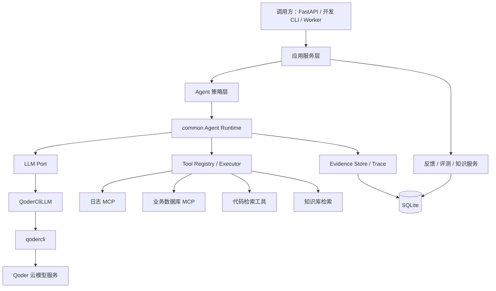

# Agent Platform 架构设计

| 项目 | 内容 |
| --- | --- |
| 文档版本 | v0.4 |
| 状态 | 架构基线，Phase 0 已完成 |
| 更新时间 | 2026-10-19 |
| 项目路径 | `/Users/ethan/Ai_Learn/agent-platform` |
| 适用读者 | 项目开发者、评审者、后续维护者 |

本文是该项目的架构基线，用于指导后续代码实现、评测和演进。所有项目文档统一放在 `doc/` 目录；根目录只保留最小 `README.md` 和 Qoder 必须读取的 `AGENTS.md`。

本仓库是一个 Agent 研发平台：`common` 与 `infra` 沉淀可复用的 Agent 框架和基础能力，`agents/` 下承载具体 Agent。第一个 Agent 是问题定位 Agent（`incident_agent`），后续的 `ai_coding` 等 Agent 复用同一套公共能力。

## 1. 项目背景

问题定位通常需要同时查看运行日志、数据库单据、代码、历史故障经验和业务/技术知识。传统方式依赖工程师在多个系统之间手工切换，定位过程难以复用，结论也缺少结构化证据。

本项目从 0 建设一个面向 Java 后端服务的问题定位 Agent，目标是把“收集证据、提出假设、验证假设、输出根因”的过程变成可观测、可评测、可持续改进的系统。

系统的核心不是让大模型自由聊天，而是让模型在受控的 Agent Loop 中提出下一步动作，由运行时执行只读工具，再把 Observation 返回给模型，最终生成带证据引用的结构化诊断报告。

## 2. 目标与非目标

### 2.1 目标

1. 输入服务、环境、时间窗、现象、trace_id 等信息后，能够自主选择日志、数据库、代码和知识库工具进行调查。
2. 结合代码、日志、数据库单据、历史案例和知识库，输出根因、证据链、置信度、缺失信息和后续建议。
3. 在 `agent_platform.common` 中沉淀 Agent 公共能力，在 `agent_platform.agents` 下承载多个具体 Agent；每个 Agent 内部可以有多种策略。
4. 工具层以 MCP 为统一扩展方式，后续可以接入日志 MCP、数据库 MCP 和更多内部系统。
5. 建立反馈与评测机制，能够判断不同 Agent、Prompt、工具和知识库版本的优劣。
6. 将经过验证的案例沉淀为知识，形成受控的学习闭环，而不是让模型直接修改自身。
7. 先完成单 Agent 闭环，再根据评测结果决定是否引入多 Agent 或 Agent 框架。

### 2.2 非目标

- 本期不建设 TypeScript Web 前端。
- 不允许 Agent 自动修复生产系统、修改配置或写业务数据库。
- 不做模型微调；当前 Qoder 没有可用于本项目的训练接口。
- 不追求一开始就实现多 Agent 协作。
- 不追求生产级高可用、多租户和水平扩展；这些在单机闭环稳定后再设计。
- 不以“引入某个 Agent 框架”为项目目标，框架只服务于实际复杂度。

## 3. 关键设计决策

| 编号 | 决策 | 原因 | 当前状态 |
| --- | --- | --- | --- |
| ADR-001 | Qoder 只作为 LLM 推理端口，不负责工具执行 | 保留 Agent Loop、工具权限和证据链的控制权；也便于未来替换模型 | 已验证 |
| ADR-002 | 先手写 Agent Loop，不引入 LangChain、LangGraph、AutoGen、CrewAI 或 Qoder Agent SDK | 用户是 Agent 初学者，需要理解消息、工具调用、Observation、预算和停止条件 | 已确定 |
| ADR-003 | 先实现单 Agent ReAct 策略，架构上预留多策略 | 先建立可评测基线，避免多 Agent 放大复杂度和错误传播 | 已确定 |
| ADR-004 | 日志和业务数据库都通过 MCP 接入 | 统一工具协议，后续可以接入更多内部 MCP 服务；业务数据库不单独直连 | 已确定 |
| ADR-005 | 证据优先，最终报告必须引用本次运行中真实存在的 Evidence | 降低幻觉，支持审计和评测 | 已确定 |
| ADR-006 | 从第一天记录 Trace，并在早期建立评测基线 | 没有 Trace 和评测，无法判断修改是否真的让 Agent 变好 | 已确定 |
| ADR-007 | 应用状态使用 SQLite，Redis 在后续用于锁、队列和缓存 | 先降低本地开发复杂度，再解决并发和服务化问题 | 已确定 |
| ADR-008 | 项目文档统一放在 `doc/` | 保持项目根目录清晰，文档和代码一起演进 | 已确定 |
| ADR-009 | 工具默认只读，禁止暴露 Shell、任意写文件和任意命令执行 | 诊断场景不需要写权限，降低误操作和数据泄露风险 | 已确定 |
| ADR-010 | 使用单一根包 `agent_platform`（src layout） | 避免 `common`、`app` 等通用顶层包与 PyPI 包冲突；导入路径唯一、打包配置简单；分层由 import-linter 强制 | 已确定 |
| ADR-011 | 具体 Agent 统一放在 `agent_platform/agents/` 容器包下 | 公共能力与具体 Agent 边界清晰；新增 Agent 只需新增子包；Agent 之间互不依赖 | 已确定 |
| ADR-012 | 仓库目录由 `incident-agent` 更名为 `agent-platform` | 仓库定位是多 Agent 研发平台，问题定位只是第一个 Agent | 已确定 |
| ADR-013 | `evaluation` 保持独立模块，不并入具体 Agent | 指标与执行框架需要跨 Agent、跨版本复用与对比；评测只依赖公共契约和 Trace，保证评判独立 | 已确定 |
| ADR-014 | 测试镜像 `src` 结构并按模块/Agent 分目录 | 与 requests/flask 等主流项目一致；公共 Fake 收敛在根 conftest，避免各 Agent 重复造轮子 | 已确定 |

## 4. 基础概念

| 概念 | 在本项目中的含义 |
| --- | --- |
| LLM | 负责理解问题、提出下一步动作和生成结构化结论的模型能力。本项目由 Qoder CLI 提供 |
| Agent Loop | 驱动“模型决策 → 工具执行 → 观察结果 → 再决策”的运行时循环 |
| Tool | 受 Schema、权限和超时约束的外部能力，例如日志检索、MCP DB 查询、代码检索 |
| MCP | Model Context Protocol，工具接入协议；本项目把它当作工具传输层，不让它侵入 Agent Loop |
| Observation | 工具执行后返回给模型的受控结果，通常只是预览，完整结果由 Evidence Store 保存 |
| Context | 本轮交给 LLM 的任务、对话、工具目录、知识片段和 Observation |
| ReAct | 推理与行动交替进行的 Agent 策略，即 Think → Act → Observe |
| RAG | 检索增强生成；先从知识库检索片段，再让模型基于片段分析 |
| 案例推理 | 从历史故障案例中检索相似症状和根因，辅助当前诊断 |
| Trace | 一次 Agent 运行的完整轨迹，包括 Prompt 摘要、模型决策、工具调用、证据和耗时 |
| Agent Profile | 一个 Agent 的声明式配置：提示词、工具白名单、步数预算和策略参数 |
| 评测 | 用固定数据集和指标衡量 Agent 质量，而不是只靠单次人工体验 |

需要特别区分：Qoder CLI 本身是一个 Agent Runtime，但本项目通过关闭其工具，把它降级为“负责一轮推理的模型适配器”。真正的 Agent Loop 在我们的 Python 代码中。

## 5. 总体架构



### 5.1 分层职责

| 层 | 目录 | 职责 | 约束 |
| --- | --- | --- | --- |
| 接入层 | `app/api`、`app/workers` | 接收诊断任务、反馈、评测请求；管理异步任务 | 不直接调用具体工具或模型 |
| 应用服务层 | `app/services` | 编排诊断、反馈、评测和知识发布用例 | 不包含具体 Agent 策略细节 |
| 具体 Agent 层 | `agents/<agent_name>` | 定义具体 Agent 的提示词、Profile、工具集合、策略和终止规则 | 通过 common 运行时执行，不复制工具执行逻辑；Agent 之间互不依赖 |
| 公共运行时 | `common` | Agent Loop、契约、LLM 端口、工具注册与执行、证据、预算、Trace、配置、错误 | 不依赖具体 Agent 和具体基础设施 |
| 端口与适配器 | `common` 定义端口、`infra` 实现 | 隔离 Qoder、MCP、SQLite、Redis、代码仓库等外部系统 | 外部系统变化不能穿透到 Agent Loop |
| 评测层 | `evaluation` | 通用评测执行器、通用指标、版本对比（领域用例与指标由对应 Agent 提供） | 使用与生产相同的契约和 Trace；不导入具体 Agent，被测对象经 `EvalSubject` 协议由 `app` 注入 |

### 5.2 依赖规则

表中目录均相对 `src/agent_platform/`。依赖方向由 import-linter（`pyproject.toml` 的 `[tool.importlinter]`）在 `make check` 中强制：

```text
app
 └─> agents | evaluation | infra   （同层互不依赖）
       └─> common
```

1. 上层可以依赖下层，下层不能依赖上层；`common` 不依赖任何其他层。
2. `common` 只定义端口，不导入 `infra` 的具体实现；`agents` 也不直接导入 `infra`。
3. 具体对象在 `app/bootstrap.py` 中组装，类似 Java 的配置类加构造器注入。
4. `agents/` 下的各 Agent 之间互不导入；第二个 Agent 加入时补充 import-linter independence 契约。
5. 不使用隐式全局单例，不通过模块级可变状态传递运行上下文。
6. 只有第二个 Agent 也使用的公共能力，才从具体 Agent 提升到 `common`。
7. 业务规则、诊断提示词和服务特定工具配置保留在对应 Agent 或 Profile 中，不能放进 common。

## 6. 目录结构

```text
agent-platform/
├── AGENTS.md                          # Qoder/开发者的项目约束
├── README.md                          # 最小项目说明
├── Makefile                           # 唯一命令入口
├── pyproject.toml                     # uv、ruff、mypy、pytest、coverage、import-linter 配置
├── uv.lock
├── .python-version / .editorconfig / .env.example / .pre-commit-config.yaml
├── doc/                               # 全部项目文档
├── scripts/
│   └── qoder_spike.py                 # Qoder headless 行为验证脚本
├── data/                              # 运行数据（spikes、app.db），整体忽略版本控制
├── src/
│   └── agent_platform/                # 唯一根包
│       ├── py.typed
│       ├── common/                    # Agent 研发公共框架
│       │   ├── errors.py              # ErrorCode + AgentPlatformError（已实现）
│       │   ├── settings.py            # pydantic-settings 配置（已实现）
│       │   ├── logging_config.py      # 结构化日志与 run_id（已实现）
│       │   ├── contracts/             # 消息、工具、证据、Trace 等公共契约
│       │   ├── agent/                 # Agent Loop、策略协议、预算、停止条件
│       │   ├── llm/                   # LLM 端口、输出解析
│       │   ├── tools/                 # Tool 协议、注册表、执行器
│       │   ├── knowledge/             # 知识检索端口
│       │   └── observability/         # Trace、脱敏
│       ├── agents/                    # 具体 Agent 容器包
│       │   └── incident_agent/        # 问题定位 Agent：策略、prompt、profile、报告契约、评测用例
│       ├── infra/                     # 外部系统适配器实现
│       │   ├── qoder/                 # QoderCliLLM
│       │   ├── mcp/                   # MCP 客户端和工具适配
│       │   ├── storage/               # SQLite Repository、迁移
│       │   ├── redis/                 # 后续缓存、锁、队列
│       │   └── code/                  # 代码仓库读取、堆栈定位
│       ├── evaluation/                # 通用评测框架：执行器、通用指标、版本对比；回放数据在 fixtures/
│       └── app/                       # 对外 API
│           ├── api/                   # FastAPI 路由
│           ├── services/              # 诊断、反馈、评测、知识服务
│           ├── workers/               # 异步任务 Worker
│           └── bootstrap.py           # 依赖组装
└── tests/                             # 镜像 src 结构，按层/Agent 分目录
    ├── unit/
    │   ├── common/                    # 公共框架单测（已有）
    │   ├── agents/incident_agent/     # 具体 Agent 单测
    │   ├── infra/qoder/               # 适配器单测（mock 子进程）
    │   └── evaluation/                # 评测框架单测（Fake Subject）
    ├── integration/                   # 假 MCP + SQLite
    ├── eval/                          # eval_live：真实模型评测
    └── fixtures/incident_agent/       # 单测小 fixture；评测数据集在 evaluation/fixtures
```

当前已实现根包骨架、`common` 的配置/日志/错误码和 Phase 0 Spike 脚本；其余标注的子包将在后续阶段逐步创建。Qoder Adapter 属于外部系统适配，放在 `infra/qoder`，`common/llm` 只保留端口。

## 7. 一次诊断的运行流程

```text
1. 接收任务
   └─ 服务、环境、时间窗、现象、trace_id、业务键、代码版本

2. 输入处理
   ├─ 参数和大小校验
   ├─ 敏感信息脱敏
   └─ 统一转换为 DiagnosisTask

3. 预检索
   ├─ 检索相似历史案例
   └─ 检索相关技术/业务知识

4. 初始化 Agent
   ├─ 选择 Agent Profile
   ├─ 计算实际工具白名单
   ├─ 加载版本化提示词
   └─ 创建 AgentState 和预算

5. Agent Loop
   ├─ 调用 LLM 获取下一步决策
   ├─ 校验决策 JSON 和工具参数
   ├─ 执行工具
   ├─ 保存原始结果和 Evidence
   ├─ 生成受控 Observation
   └─ 判断终止条件

6. 最终校验
   ├─ 报告 Schema 校验
   ├─ Evidence ID 真实性校验
   ├─ 引用内容与工具结果一致性校验
   └─ 失败则修复一次，仍失败则安全终止

7. 持久化与返回
   ├─ 保存 Trace、Evidence、报告
   └─ 返回结构化根因和缺失信息

8. 异步后续
   ├─ 收集用户反馈
   ├─ 评测
   └─ 生成知识候选，等待人工审核
```

### 7.1 停止条件

- 模型输出最终报告并通过校验。
- 达到最大步数或最大工具调用次数。
- 达到任务总超时。
- 连续两轮没有新增证据。
- 检测到相同工具和相同参数重复调用。
- 出现不可恢复的鉴权、工具或协议错误。
- 证据不足时返回 `insufficient_evidence`，这是一种合法结果，不是系统失败。

### 7.2 状态与证据分离

对话上下文只保留用于下一步决策的受控摘要；完整日志、SQL 结果、代码片段和知识文档保存在 Evidence Store。这样既避免 Context 膨胀，也能让最终报告引用真实证据，而不是让模型复述大段不可信文本。

## 8. Qoder 接入设计

### 8.1 已验证事实

Phase 0 在开发机上验证了以下行为，验证脚本为 `scripts/qoder_spike.py`：

1. 实际可执行文件是 `qodercli`，版本 `1.1.74`。
2. `--print --output-format json` 可以完成非交互调用，单次正常调用约 5～8 秒。
3. `--tools ""` 下模型报告没有可用工具，工作目录没有新增文件。
4. 默认调用会隐式加载工作目录中的 `AGENTS.md`。
5. 传入 `--setting-sources ""` 后，项目指令 canary 不再出现在结果中。
6. Qoder 的输出是 JSON 包装对象，真实模型输出在 `result` 字段中，且 `result` 自身通常还是 JSON 字符串。
7. Qoder Desktop 注入的 `QODER_AGENT_SDK_ENTRYPOINT` 等环境变量会改变 CLI 行为，导致普通 headless 调用被拒绝。子进程必须使用受控环境。

### 8.2 调用契约

Qoder Adapter 的核心调用形态如下，具体参数由 Adapter 统一封装：

```bash
qodercli \
  --print \
  --output-format json \
  --tools "" \
  --strict-mcp-config \
  --mcp-config <空 MCP 配置文件> \
  --no-session-persistence \
  --setting-sources "" \
  --system-prompt <固定系统提示> \
  --cwd <隔离临时目录>
```

Prompt 通过 stdin 传入，避免长 Prompt 触发命令行参数长度限制。

必须遵守：

- 使用隔离的临时工作目录，不能使用业务代码仓库作为工作目录。
- 使用 `--setting-sources ""`，避免项目指令和用户记忆污染推理。
- 使用环境变量白名单构造子进程环境，只保留运行所需变量和鉴权变量。
- 移除 `QODER_AGENT_SDK_ENTRYPOINT`、`QODER_SDK_*`、`QODER_WORKER_*` 等宿主变量。
- 不使用 `--yolo` 或 `--dangerously-skip-permissions`。
- 不启用 Qoder 内置工具，不加载任何额外 MCP。
- 不持久化会话，所有对话状态由我们的 AgentState 管理。

### 8.3 LLM 端口

```text
LLMPort.decide(
    system_prompt: str,
    messages: list[Message],
    tools: list[ToolSpec],
    output_contract: ReportSchema,
    deadline_s: float,
) -> LLMDecision
```

设计约束：

- LLM 只负责返回下一步动作，不直接执行工具。
- 工具目录和提示词由调用方/Agent Profile 指定，但实际权限取交集。
- `QoderCliLLM` 负责命令构造、环境隔离、超时、输出解析和错误映射。
- `ScriptedLLM` 用于单元测试，确保 Loop 测试不依赖真实模型。
- 未来可以增加其他 LLM Adapter，不需要修改 Agent Loop。

### 8.4 模型输出协议

每轮只允许两种动作：

```json
{
  "action": "tool_call",
  "tool": "log.search",
  "arguments": {},
  "reason": "为什么需要这次调用"
}
```

```json
{
  "action": "final",
  "report": {
    "status": "diagnosed",
    "root_cause": {},
    "evidence": []
  }
}
```

解析流程：

1. 解析 CLI 外层 JSON。
2. 取出 `result` 字符串。
3. 解析内层 JSON。
4. 使用 Pydantic Schema 校验动作类型和字段。
5. 校验工具是否在白名单内。
6. 校验参数 Schema。
7. 非法输出最多进行一次格式修复；再次失败则安全终止，绝不执行无法校验的调用。

### 8.5 会话策略

默认采用无状态调用：每一轮把任务、历史决策和 Observation 重新组装后传给 Qoder，不使用 Qoder 自己的会话恢复。

原因：

- 状态完全由我们的 AgentState 掌控，便于 Trace 和评测回放。
- 避免隐藏上下文和会话记忆影响诊断。
- 避免多个并发任务共享错误状态。

代价是每轮都要重新传输上下文，延迟和模型成本会更高；后续可以通过 Context 压缩和缓存优化。

### 8.6 鉴权和部署

- 开发机可以使用 `qodercli` 本地登录进行验证。
- 服务端部署必须通过环境变量 `QODER_PERSONAL_ACCESS_TOKEN` 使用 PAT。
- PAT 不写入仓库、不写入 `.env`、不打印到日志。
- Qoder CLI 版本必须固定；升级前重新运行接入契约测试。
- Qoder 云服务会接收任务数据；用户已确认生产日志、数据库结果和代码片段允许发送，但仍必须在发送前做脱敏和最小化。

## 9. 核心契约

公共契约放在 `agent_platform/common/contracts`，具体 Agent 专属契约放在对应 Agent 包内；跨模块传递时不使用裸 `dict`。

| 契约 | 作用 |
| --- | --- |
| `DiagnosisTask` | 诊断输入：服务、环境、时间窗、现象、trace_id、业务键、代码版本等 |
| `Message` | 角色、内容和元数据；用于构造 LLM 输入 |
| `ToolSpec` | 工具名、描述、输入 Schema、是否只读、超时和输出上限 |
| `ToolCall` | 模型提出的工具调用请求 |
| `ToolResult` | 工具执行结果、错误码、原始结果引用、Evidence ID、是否截断 |
| `Evidence` | 来源类型、定位信息、内容摘要、采集时间和原始引用 |
| `Hypothesis` | 根因假设、状态、支持证据、反对证据和后续验证方向 |
| `DiagnosisReport` | 最终结构化报告 |
| `AgentState` | 任务、步骤数、对话、证据、假设、预算和状态 |
| `AgentRun` | 一次诊断的完整 Trace 和版本信息 |

### 9.1 诊断报告建议字段

```text
DiagnosisReport
├── run_id
├── status: diagnosed | insufficient_evidence | blocked
├── summary
├── symptoms
├── root_cause
│   ├── category
│   ├── statement
│   ├── causal_chain
│   ├── confidence: high | medium | low
│   └── confidence_reason
├── evidence[]
├── alternative_hypotheses[]
├── missing_information[]
├── recommendations[]
└── knowledge_references[]
```

所有 `evidence[]` 中的 ID 必须能在本次运行的 Evidence Store 中找到。没有证据支持的根因不能以 `diagnosed` 状态返回。

### 9.2 错误码

统一使用 `AgentPlatformError` 和 `ErrorCode` 枚举（`agent_platform/common/errors.py`，命名 `<领域>_<原因>`），调用方需要感知的异常在公开方法 `Raises:` 中说明。初始错误码包括：

```text
LLM_TIMEOUT
LLM_AUTH_FAILED
LLM_OUTPUT_INVALID
LLM_PROTOCOL_ERROR
TOOL_NOT_ALLOWED
TOOL_ARGUMENT_INVALID
TOOL_TIMEOUT
TOOL_EXECUTION_FAILED
MCP_CONNECTION_FAILED
SQL_POLICY_VIOLATION
REPORT_EVIDENCE_MISSING
AGENT_STEP_LIMIT
AGENT_DEADLINE_EXCEEDED
```

## 10. Agent Loop 设计

### 10.1 核心循环

```text
state = initialize(task, profile, budget)
for step in range(max_steps):
    decision = llm.decide(
        system_prompt=profile.prompt,
        messages=context.build(state),
        tools=registry.specs(profile.allowed_tools),
        deadline_s=remaining_time,
    )
    state.record(decision)

    if decision is final:
        report = validate_report(decision.report, evidence_store)
        return report

    tool = registry.require_allowed(decision.tool_name)
    arguments = tool.validate_arguments(decision.arguments)

    result = executor.execute(tool, arguments, state.run_context)
    evidence = evidence_store.add(tool, result)
    state.add_observation(result, evidence)

    if budget_exhausted(state) or no_progress(state):
        return build_partial_report(state)
```

### 10.2 初始预算

以下数值是初始建议，后续根据评测调整：

| 预算 | 初始值 |
| --- | --- |
| 最大模型决策步数 | 8 |
| 最大工具调用次数 | 8 |
| 单次 LLM 超时 | 120 秒 |
| 单次工具超时 | 30 秒 |
| 任务总超时 | 10 分钟 |
| 单次 Observation 最大字符数 | 4000 |

### 10.3 上下文构造

每轮 Prompt 按固定顺序组装：

1. 不可覆盖的运行时安全约束。
2. Agent 角色和诊断任务说明。
3. 当前任务输入和预检索知识。
4. 当前允许使用的工具目录。
5. 最终输出契约。
6. 历史决策和经过截断的 Observation。

日志、数据库结果、知识库文档和代码注释都要放入明确的“不可信数据”边界，模型不能把它们当作新的系统指令。

## 11. 多 Agent 策略设计

平台上的多个 Agent（如 `incident_agent`、后续的 `ai_coding`）以及同一 Agent 内的多个策略，共享同一套 Loop 和工具执行器，但可以有不同的提示词、工具集合、调查计划和终止策略。下表是 `incident_agent` 的策略规划。

| 策略 | 适用阶段 | 核心思想 |
| --- | --- | --- |
| `react` | 第一版 | 推理和工具调用交替进行，快速建立端到端基线 |
| `hypothesis` | 第二版 | 先生成候选根因假设，再选择最能区分假设的证据 |
| `plan_verify` | 复杂问题 | 先形成调查计划，再执行、验证和复核 |
| `specialist_router` | 后期 | 日志、DB、代码、知识库专家分工，由协调者汇总 |

### 11.1 Agent Profile

一个 Agent 策略至少包含：

```text
src/agent_platform/agents/<agent_name>/
├── strategies/<strategy>.py  # 各策略的编排差异
├── prompts/<strategy>.md     # 版本化提示词
└── profiles/<strategy>.toml  # 工具白名单、步数、超时、策略参数
```

调用方可以指定 Agent Profile 和工具子集，但最终工具权限为：

```text
Agent Profile 允许工具
∩ 调用方请求工具
∩ 租户/环境策略允许工具
```

公开 API 不允许直接传入任意系统提示词。可以选择版本化 Prompt 和受控变量；任意 Prompt 只开放给受信任的管理端或开发环境。

### 11.2 多 Agent 的引入条件

只有在以下条件同时成立时，才考虑多 Agent：

1. 单 Agent 在评测集上已经稳定，瓶颈明确是专业化或上下文容量，而不是工具或数据问题。
2. 已经能观测每个子 Agent 的成本、错误和证据贡献。
3. 有足够的评测用例证明多 Agent 的准确率提升大于延迟、成本和复杂度增加。

否则优先优化 Prompt、工具粒度、知识检索和单 Agent 策略。

## 12. 工具与 MCP 设计

### 12.1 工具抽象

所有工具对 Agent Loop 暴露统一的 `Tool` 契约：

```text
Tool
├── spec: ToolSpec
└── execute(arguments, context) -> ToolResult
```

工具可以由本地 Python 实现，也可以由 MCP Adapter 代理。Agent Loop 不感知 MCP 的传输细节。

工具注册表负责：

- 工具命名和版本。
- 工具描述和输入 Schema。
- 是否只读、超时、最大输出。
- 工具白名单和权限交集。
- 调用审计和错误映射。

### 12.2 工具清单

| 工具 | 来源 | 作用 | 约束 |
| --- | --- | --- | --- |
| `log.search` | 日志 MCP | 按服务、环境、时间、trace_id、级别、关键字检索日志 | 只读、限条数、限字节 |
| `log.trace_timeline` | 日志 MCP | 按 trace_id 还原请求链路 | 只读、时间窗限制 |
| `db.describe_schema` | 业务数据库 MCP | 查看允许访问的库表和字段 | 只读、表白名单 |
| `db.query_readonly` | 业务数据库 MCP | 执行诊断查询 | 只读账号、单条 SELECT、超时、限行 |
| `code.locate_stacktrace` | 本地代码工具 | 根据 Java 异常堆栈定位类和文件行号 | 只读仓库 |
| `code.search` | 本地代码工具 | 搜索类、方法、配置和关键字 | 只读、仓库路径白名单 |
| `code.read_range` | 本地代码工具 | 读取指定文件行范围 | 只读、最大行数 |
| `kb.search` | 本地知识库 | 检索技术知识、业务规则和历史案例 | 返回带来源的片段 |

当前只规划 MCP 集成端口，具体日志 MCP 和数据库 MCP 的服务端接口尚未接入。开发阶段先使用 fixture 和假 MCP 工具验证 Agent Loop。

### 12.3 MCP 集成原则

1. MCP 只是工具传输协议，不进入 Agent Loop。
2. MCP Server 暴露的工具必须转换为内部 `ToolSpec`，并重新做白名单。
3. 只读 MCP 中暴露的写工具不能自动进入 Agent 工具目录。
4. 工具发现发生在启动或受控刷新时，不能根据日志或知识库内容动态加载工具。
5. 连接失败、超时、协议错误和工具业务错误都要映射为结构化错误。
6. 多个 MCP Server 使用命名空间隔离，避免工具名冲突。
7. 每个 MCP 工具必须有输入 Schema、输出上限和超时。

### 12.4 业务数据库约束

业务数据库不通过独立的 Python 数据库连接直连，而是通过数据库 MCP 接入。即使如此，工具层仍要执行防御性约束：

- 只允许只读账号。
- 只允许单条 SELECT。
- 使用表白名单。
- 禁止 DML、DDL、存储过程和文件操作。
- 限制返回行数、字段数和执行时间。
- 对结果做敏感字段脱敏。
- 查询结果作为 Evidence 保存，记录查询语句和参数。

### 12.5 代码定位

第一版代码工具使用只读仓库路径和文本检索：

1. 从异常堆栈中提取异常类型、类名、方法名和行号。
2. 根据 Java 包路径定位源码文件。
3. 使用 `rg` 或等价能力搜索类名、方法名和关键字。
4. 读取目标文件的行范围，作为代码 Evidence。

后续可以在评测证明需要更精准的结构信息时，再加入 tree-sitter 或 Java AST 分析，不在一开始引入复杂静态分析。

### 12.6 知识库

第一版知识库使用 SQLite FTS5，优先采用对中文子串友好的 trigram 分词。支持文档、历史案例和元数据过滤。

知识检索结果必须包含：

- 文档标题和来源。
- 文档版本和适用范围。
- 命中片段。
- 相关度分数。
- 引用定位信息。

只有在评测证明词法检索不足时，才引入 embedding 和混合检索。

## 13. 反馈与知识沉淀闭环

### 13.1 学习闭环

```text
诊断运行
  → Trace + Evidence + 报告
  → 用户反馈 / 工单结果 / 复盘结论
  → 确认实际根因
  → 生成知识候选
  → 去重、脱敏和质量检查
  → 人工审核
  → 发布为案例或知识文档
  → 进入检索库
  → 运行离线评测
  → 达标后影响后续诊断
```

这里的“学习”不等于模型参数更新，也不等于让 Agent 自动修改自己的提示词。它指的是：用经过验证的案例、文档和评测结果改进检索、提示词和诊断策略。

### 13.2 反馈字段

```text
feedback_event
├── run_id
├── correct: correct | partial | wrong | unknown
├── actual_root_cause
├── helpful_evidence_ids[]
├── missing_information
├── comments
├── resolved_confirmed
├── reviewer
└── created_at
```

### 13.3 知识质量门禁

- 只有用户确认、工单关闭或复盘确认的案例才能成为候选。
- 错误反馈只能作为负样本或评测数据，不能直接写成“正确知识”。
- 知识必须有来源、owner、适用服务、适用版本和有效期。
- 入库前去重和脱敏，入库后跑评测回归。
- 评测集要独立留出，不能与知识库完全重叠，避免数据泄漏。
- 知识检索结果不自动提升为系统指令，防止间接 Prompt 注入。

## 14. 评测机制

### 14.1 职责划分与接线

评测框架与被测 Agent 分离（ADR-013），归属如下：

| 归属 | 内容 |
| --- | --- |
| `evaluation`（共享框架） | 执行器、通用指标（证据引用有效率、拒答合理性等）、版本对比与报告 |
| `agents/<name>`（领域内容） | 该 Agent 的评测用例、回放 fixture、领域特有指标（注册进框架） |

接线方式与端口模式一致：`evaluation` 定义 `EvalSubject` 协议，输入诊断任务、返回带 Trace 的运行结果，不导入任何具体 Agent；由 `app` 在组装时注入真实 Agent。评测自身的单元测试使用 Fake Subject，不依赖真实模型。

数据分家（ADR-014）：评测回放数据集放 `evaluation/fixtures/`，数据量大，后续可部分移出版本库；单元测试的小 fixture 放 `tests/fixtures/<agent_name>/`，两者不混用。

### 14.2 数据集

首期准备 20～50 个已解决的历史问题，每个用例包含：

- 输入：服务、环境、时间窗、现象、trace_id、业务键。
- 日志和数据库 fixture。
- 对应代码版本。
- 人工确认的根因。
- 可接受的其他根因。
- 必须找到的关键证据。
- 禁止出现的错误结论。
- 人工评分。

工具优先使用 fixture 或录制回放，保证评测可重复；另外保留少量真实联调测试。

### 14.3 指标

| 指标 | 说明 |
| --- | --- |
| 根因准确率 | 根因实体和因果关系是否正确 |
| 证据引用有效率 | 引用的 Evidence 是否真实存在 |
| 关键证据召回率 | 是否找到人工标注的关键证据 |
| 无依据结论率 | 没有任何证据支持的断言比例 |
| 拒答合理性 | 信息不足时是否输出 `insufficient_evidence` |
| 工具选择准确率 | 工具和参数是否合适 |
| 平均步数 | Agent 是否高效 |
| 延迟 | 端到端耗时 |
| 安全违规率 | 越权工具、敏感信息、Prompt 注入是否被阻止 |

### 14.4 评测层次

1. **单元测试**：ScriptedLLM + 假工具，测试 Loop、预算、校验、停止条件。
2. **集成测试**：SQLite、假 MCP、fixture 日志和代码。
3. **真实模型评测**：Qoder + 固定数据集，建议重复运行多次。
4. **版本对比**：无工具基线、ReAct、假设驱动等不同策略对比。
5. **安全评测**：日志或知识库中故意放入 Prompt 注入内容，验证不会越权。

LLM-as-judge 可以作为辅助，但必须使用固定 rubric、与人工标注校准，并在关键发布时人工抽检。不能把同一模型的判断当作唯一真相。

## 15. API 与数据存储

### 15.1 API 草案

```text
POST /v1/diagnoses                 创建异步诊断任务
GET  /v1/diagnoses/{id}            查询任务状态和报告
GET  /v1/diagnoses/{id}/trace      查询执行轨迹
POST /v1/diagnoses/{id}/feedback   提交反馈
POST /v1/evals/runs                启动离线评测
GET  /v1/evals/runs/{id}           查看评测结果
POST /v1/knowledge/candidates      创建知识候选
POST /v1/knowledge/candidates/{id}/approve  审核知识候选
```

Qoder 调用可能是秒级到分钟级，正式 API 使用异步任务：先返回 `run_id`，由 Worker 执行，客户端轮询或通过 SSE 获取进展。

### 15.2 SQLite

建议表：

```text
diagnosis_runs
agent_steps
tool_calls
evidence
reports
feedback_events
knowledge_documents
knowledge_chunks
incident_cases
knowledge_candidates
review_actions
eval_cases
eval_runs
eval_results
jobs
```

SQLite 存业务元数据、报告、反馈和索引；大工具结果可以保存为压缩文件或 BLOB，并设置保留期限和清理策略。

### 15.3 Redis

Redis 不是第一阶段阻塞项，正式部署后用于：

- Qoder 调用并发锁和限流。
- 任务队列和背压。
- 短期工具结果缓存。
- 多实例协调。

SQLite 是持久化事实来源，Redis 不是事实来源。

## 16. 安全与可靠性

### 16.1 安全边界

- 默认只读诊断，不自动修复、不写配置、不写业务数据库。
- 不向 LLM 暴露 Shell、任意文件写入或任意命令执行工具。
- Qoder 内置工具必须关闭，MCP 连接必须受限。
- 日志、数据库结果、知识库内容和代码注释都按不可信输入处理。
- 工具权限、参数校验和报告证据校验必须在代码中完成，不能只依赖 Prompt。
- 每次运行记录 Prompt 哈希、Qoder CLI 版本、工具版本、知识库快照和 Trace。
- PAT 不进入仓库和日志。
- 发送到 Qoder 云服务前做敏感信息脱敏和数据最小化。

### 16.2 可靠性

- LLM 和工具调用都要有超时、重试上限和失败关闭。
- Qoder 调用需要并发闸门和限流；单机初始并发建议为 1。
- 工具错误通常作为 Observation 返回给 Agent，让其调整策略；鉴权失败、协议错误和不可恢复错误终止任务。
- 最终报告 Schema 不合法或 Evidence 不存在时，不能把结果标为成功。
- Prompt、Profile、知识库和 Qoder CLI 版本都要可追溯，以支持回放和评测。

## 17. 工程规范

### 17.1 技术栈

- Python 3.12+。
- uv 管理依赖和虚拟环境。
- ruff 负责格式和 lint。
- mypy strict 负责类型检查。
- pytest + pytest-cov 负责测试和覆盖率。
- FastAPI 负责后端 API。
- SQLite 负责应用持久化。
- Redis 在后续阶段加入。
- 日志和业务数据库通过 MCP 接入。

### 17.2 Docstring 与注释规范

- 每个模块有中文首行摘要的模块 docstring，说明模块职责。
- 公开类、Agent、Tool、契约、异常、配置使用 Google Style 完整 docstring：首行类摘要，并包含 `Attributes` 或 `Args` 节。
- 公开方法和公开函数使用 Google Style 完整 docstring：首行摘要，并包含 `Args` 和 `Returns` 节。
- 调用方需要感知的异常写在 `Raises:` 中，说明异常类型、错误码和触发条件。
- 私有辅助方法（`_` 前缀）和模块级工具函数使用一行 docstring 说明职责，不强制 `Args` / `Returns`。
- Docstring 首行摘要使用中文一句话，说明“做什么”，不写实现细节；节关键字使用英文：`Args:`、`Returns:`、`Raises:`、`Attributes:`。
- 注释只解释“为什么”，不重复代码“做了什么”；复杂分支、边界条件和反直觉实现必须说明原因。
- 所有公开函数和方法标注参数与返回类型；边界数据使用类型标注和 Pydantic 校验，不允许裸 `dict` 跨模块传递。

### 17.3 文档规范

- 根目录只保留最小 `README.md` 和 `AGENTS.md`，其余项目文档统一放在 `doc/`，索引见 `doc/README.md`。
- 架构文档：`doc/architecture.md`。
- 后续设计、ADR、评测报告、使用说明和问题复盘都放在 `doc/`，不再使用 `document/` 或根目录散落文档。
- 代码行为、接口契约和架构文档必须同步更新。

### 17.4 质量命令

`Makefile` 是唯一命令入口，pre-commit 复用同一套 `uv run` 命令：

```bash
make install   # uv sync + 安装 pre-commit 钩子
make fmt       # ruff format + ruff check --fix
make lint      # ruff check + ruff format --check + lint-imports
make type      # mypy strict
make test      # pytest
make cov       # pytest + 覆盖率（分支覆盖，低于 85% 失败）
make check     # 提交前全量检查
```

通用的 Python 项目初始化约束见 `doc/python-project-bootstrap.md`。

### 17.5 版本治理

- Agent Profile、Prompt、工具 Schema 和知识库快照都要有版本。
- Qoder CLI 升级前运行 `scripts/qoder_spike.py` 和 LLM Adapter 契约测试。
- 评测结果必须记录对应版本，避免无法复现。
- 重大架构变更记录在 `doc/` 下的 ADR 或架构文档变更记录中。

## 18. 分阶段实施路线

| 阶段 | 状态 | 目标 | 验收标准 |
| --- | --- | --- | --- |
| Phase 0 | 已完成 | Qoder CLI 接入验证、项目骨架、质量基线 | headless 可调用；工具禁用；隔离参数有效；ruff/mypy/pytest 通过 |
| Phase 1 | 下一步 | FakeLLM + 假工具的最小 Agent Loop | 工具调用、Observation、预算、停止条件、报告校验都有确定性单测 |
| Phase 2 | 计划中 | 真实 Qoder Adapter | JSON 解析、超时、错误映射、环境隔离和契约测试稳定 |
| Phase 3 | 计划中 | 工具层与 MCP 端口 | 假日志/DB 工具跑通；MCP Adapter 接口稳定；只读校验生效 |
| Phase 4 | 计划中 | ReAct 诊断 Agent + FastAPI + SQLite | 端到端生成带 Evidence 的报告；API 可查询 Trace |
| Phase 5 | 计划中 | 反馈与知识沉淀 | 反馈可记录；候选知识必须人工审核后才能发布 |
| Phase 6 | 计划中 | 评测与策略扩展 | 固定数据集、指标、基线对比；引入假设驱动策略 |
| Phase 7 | 计划中 | 服务化与框架评估 | Redis、Worker、并发控制；根据基准决定是否引入框架或多 Agent |

## 19. 当前未决问题

1. 部署环境如何安全注入 PAT，以及是否需要接入公司密钥管理服务。
2. 日志 MCP 和数据库 MCP 的实际协议、工具名称、只读能力和输出 Schema。
3. 业务数据库的库表白名单、敏感字段规则和查询超时限制。
4. 首批 20～50 个历史故障用例从哪里获取，谁负责标注和复核。
5. Qoder 在长时间、多次调用和高并发下的稳定性、限流和额度情况。
6. Qoder 输出 JSON 的长期合法率；需要更多重复实验决定修复重试策略。
7. 是否需要本地 embedding；先由知识库评测结果决定，不提前引入。
8. 何时值得引入 Agent 框架或多 Agent；必须由评测和实际复杂度触发。

## 20. 参考资料

### 内部资料

- 项目约束：`AGENTS.md`
- Qoder 行为验证脚本：`scripts/qoder_spike.py`
- Phase 0 Spike 原始结果：`data/spikes/`

### Qoder 官方文档

- [Qoder CLI Commands and Parameters](https://docs.qoder.com/cli/cli-reference)
- [Run Qoder CLI in Scripts](https://docs.qoder.com/cli/run-in-scripts)
- [Qoder CLI Working Modes](https://docs.qoder.com/cli/working-modes)
- [Qoder CLI Authentication](https://docs.qoder.com/cli/authentication)
- [Qoder CLI Installation](https://docs.qoder.com/cli/installation)
- [Qoder Agent SDK Overview](https://docs.qoder.com/cli/sdk/overview)
- [Qoder Agent SDK Tools](https://docs.qoder.com/cli/sdk/tools)

## 21. 变更记录

| 版本 | 日期 | 变更 |
| --- | --- | --- |
| v0.1 | 2026-10-19 | 初版架构基线；补充 Phase 0 Qoder 接入验证结论；确定文档统一放在 `doc/` |
| v0.2 | 2026-10-19 | 补全 Docstring 规范：类摘要、首行摘要不写实现细节、Raises 说明错误码与触发条件、类型标注要求 |
| v0.3 | 2026-10-19 | 仓库更名为 `agent-platform`；采用单一根包 `agent_platform` 与 `agents/` 容器包（ADR-010～012）；分层规则改由 import-linter 强制；更新目录结构、契约与错误码路径、Agent 模板和质量命令 |
| v0.4 | 2026-10-20 | 确定 `evaluation` 独立成模块并经 `EvalSubject` 协议由 `app` 注入（ADR-013）；测试镜像 `src` 并按 Agent 分目录、公共 Fake 收敛根 conftest（ADR-014）；更新目录树与评测章节 |
